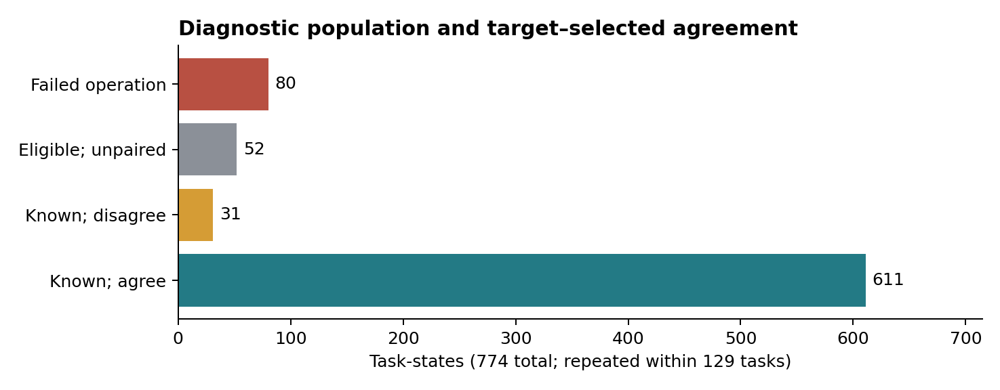
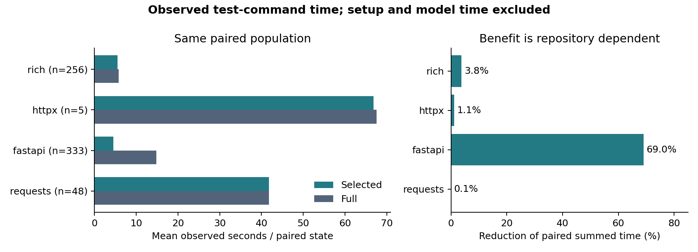
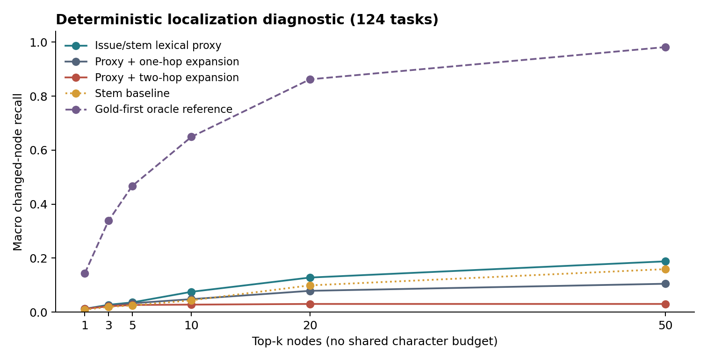

# ATLAS: Auditing Static Graph Diagnostics for Repository Repair Under Limited Compute

## Abstract

Static repository graphs can support localization and test selection, but inexpensive offline measurements can overstate what has been established about a repair agent. We present ATLAS, a reproducible audit and lightweight Python resource built around the Gemma 4 Developer Agent task corpus. Across 129 tasks, 127 graph identities, and 774 nonbaseline task-states, 80 attempted operations failed and 52 remaining states lacked a known target–selected comparison. The 642 paired states show 95.17% agreement in baseline-relative failure diagnostics, despite widespread collection errors. Selected test-command time is 39.55% lower in aggregate, with benefits concentrated in FastAPI. On 124 localization tasks, a deterministic lexical proxy achieves 0.1879 changed-node recall@50; a gold-informed ordering reaches 0.9817. These are diagnostic measurements, not agent repair scores or an information-delivery bound. The released audit preserves unknown outcomes, records provenance, and separates reproducible observations from claims requiring an actual agent experiment.

## 1. Motivation and relation to prior work

Repository repair combines issue understanding, localization, patch construction, and validation. SWE-bench formalizes repair against real repository issues and tests [1]. Agentless separates localization, repair, and validation [2], while RepoGraph investigates graph-assisted navigation for software engineering agents [3]. Regression test selection has a longer history: Ekstazi uses dynamic file dependencies to reduce Java test execution [4]. Our Python static-call-graph diagnostic differs in dependency source, execution environment, and acceptance criterion; its timings are not a direct comparison with these systems.

We ask a narrower question: what can an affordable offline graph study establish before committing scarce GPU time to an agent evaluation? Our contribution is an auditable account of selection populations, execution evidence, deterministic localization proxies, and their limitations. The Paper Track accepts relevant research independently of a main-track score [5]. We therefore report the completed offline study without substituting a proxy result for an agent result.

## 2. Corpus, methods, and evidence

The local corpus contains 129 task records from Rich (48), HTTPX (1), FastAPI (67), and Requests (13). Task-to-graph mappings cover all tasks but refer to 127 unique repository/commit keys. Five tasks have no matching changed-node gold set, leaving 124 for localization. Repeated states within a task are not independent observations.

### 2.1 Execution diagnostic

For each task, the historical container experiment records a baseline and six other states: gold patch, noop, revert, syntax perturbation, comment perturbation, and wrong-file perturbation. Revert applies gold and then resets to the baseline; it duplicates the noop control family rather than providing an independent negative intervention. A successful operation only establishes that its modification was applied, not that it changed the intended behavior.

Three commands are compared: AST-derived test-patch targets, graph-selected test files, and the full test-file list. The released selector starts from candidate changed-file symbols, follows reverse call reachability, and unions tests with lexical filename/issue overlap. The historical perturbation runner selected once from gold-changed files before its variant loop, so those diagnostic comparisons carry an information advantage; they are not an issue-only end-to-end repair trial. Gold/test-patch information is used for offline interventions and diagnostic labels.

The historical delta is the difference between current and baseline failing-test sets for each command. A delta-clean result may retain pre-existing failures or collection errors. Our audit reports it separately from absolute command status and required-test coverage. Absolute pass requires a zero return code, valid JUnit counts, at least one unskipped test, and no failures/errors. Missing XML, unenumerated parametrization, and unavailable required-test inventories cannot establish required-test acceptance. The corpus lacks official FAIL_TO_PASS/PASS_TO_PASS inventories, so official resolved status is unknown throughout.

We select one source record per task from nine non-merged JSON files: latest valid per-record finish time, then start time, followed by explicit evidence/source/hash tie-breaks. The 132 input records yield 129 selected tasks. The chosen records match the historical selection in this snapshot. A frozen manifest and per-row source references preserve the distinction between raw evidence and regenerated statistics.

### 2.2 Localization diagnostic

The issue text is compared with node filename stems using Jaccard overlap (B0). This is a lexical proxy, not the official embedding search and not a mathematically established lower bound. B1 interleaves each of ten B0 seeds with sorted one-hop neighbors; B2 contains the top seed and its one-hop neighborhood. The experiment intentionally preserves these historical algorithms while making tie and set ordering deterministic. The accompanying library additionally repairs seed retention and node-budget behavior; those changes must not be confused with the reported historical algorithm.

The gold set includes graph nodes belonging to Python files changed by the reference patch. It is a coarse file-derived target, not a verified minimal causal symbol set. The oracle reference orders gold nodes first; it uses unavailable answer information and does not traverse a one-hop oracle graph, despite its retained legacy JSON key. All methods are evaluated at fixed node counts without a shared character cap. No model-context delivery, token savings, or repair gain follows from their recall ratio.

## 3. Results

### 3.1 Valid populations and diagnostic disagreement

The 903 observed states comprise 129 baselines and 774 other states. Eighty attempted operations failed: nine syntax, nine comment, and 62 wrong-file operations. Excluding them leaves 694 eligible states, of which 642 have known target and selected deltas. These agree in 611 cases (95.17%). All 31 disagreements are target-clean/selected-regress. Unknown outcomes remain outside the agreement denominator.

*Figure 1. Partition of all 774 nonbaseline states. Operations and controls are repeated within 129 tasks; 52 eligible states lack a known paired comparison. The chart reports a baseline-relative diagnostic, not successful repairs.*

On the same 642-state selected/full population, 638 deltas agree (99.38%); four are full-regress/selected-clean. This does not certify broad validation: among all 774 states, 671 selected-command rows and 686 full-command rows contain explicit collection-failure evidence. Shared collection failures can create agreement without exercising the intended behavior. Across the 129 gold states, only three selected commands and one full command meet local absolute-pass checks; target commands pass in 87. These contrasts make absolute and differential results indispensable to interpretation.

The old 684/730 (93.70%) statistic mixed failed injections into a target-known denominator. Removing failed injections gave 611/650 (94.00%), still treating eight selected-unknown cases as disagreements. The paired 611/642 denominator is the consistent descriptive comparison. None of these rates measures an agent's ability to solve tasks.

The supplemental continue-on-collection-error command ran on 170 nonbaseline states. Under the explicit rule “original target delta unknown, supplemental target delta known,” it rescues zero states. Its previous successful-command count must not be described as rescued task acceptance.

### 3.2 Observed cost and repository dependence

For 642 matched selected/full state pairs across 124 tasks, excluding failed operations, timeouts, unknown deltas, and invalid timings, selected commands total 5,293.7 seconds against 8,757.8 seconds for full commands: a 39.55% reduction of summed time. Means are 8.25 versus 13.64 seconds; medians are 5.3 versus 8.2 seconds. Averaging variants within each task before equal-task aggregation gives a 38.37% reduction.

| Repository | Paired states | Tasks | Reduction of summed command time |
|---|---:|---:|---:|
| Rich | 256 | 44 | 3.77% |
| HTTPX | 5 | 1 | 1.07% |
| FastAPI | 333 | 67 | 69.02% |
| Requests | 48 | 12 | 0.11% |

*Figure 2. Identical eligible pairs for selected and full commands, with repository-specific denominators. Times include failed commands, often collection failures. Setup and model/agent-loop time are excluded. These are not successful-test throughput or end-to-end speedup measurements.*

FastAPI dominates the aggregate reduction and also has severe collection-failure contamination. Thus the timing result supports an observation about these commands, not a claim that useful validation became 39.55% cheaper. Historical setup time across 129 tasks averages 14.61 seconds, with median 14.0 and range 6.5–40.7 seconds; it is a separate accounting category. We report no inferential significance from the repeated-state count.

### 3.3 Deterministic localization and proxy sensitivity

Two fresh runs under PYTHONHASHSEED=0 and 42 produce identical semantic results on 124 tasks. B0 changed-node recall@50 is 0.1879, compared with 0.1049 for B1 and 0.0301 for B2. The stem baseline reaches 0.1591; random ordering reaches 0.0236. Gold-first ordering reaches 0.9817 and MRR 1.0 by construction. B0's MRR is 0.0864.

*Figure 3. Macro changed-node recall on 124 tasks with a nonempty gold set. Node budgets are comparable; character/token budgets are not imposed. The dashed gold-first series is an answer-informed reference, not an implementable retrieval method.*

Stable tie ordering changes historical B0 recall@50 from 0.1773 to 0.1879 and MRR from 0.0457 to 0.0864. The scripts save this drift rather than overwriting the earlier result. Neighborhood expansion reduces recall in this particular ranking diagnostic; this does not establish that graph expansion generally harms retrieval. Ordering, target construction, seed retention, and a real query encoder require separate controlled evaluation.

## 4. Resource, compute policy, and reproducibility

The resource includes the Atlas Python package, targeted regression tests, deterministic audit scripts, CSV claim tables, source-linked figures, a CPU reproduction notebook, and a bounded Kaggle runtime notebook. Original snapshots, graphs, model weights, and competition wheels are not redistributed in the release archive. Users obtain official inputs through the competition and retain their original licenses. The reproduction notebook reruns aggregation from raw inputs when available and explicitly labels the bundled derived-table path otherwise.

Library repairs include safe recursive YAML references, model declaration checks, the LlmAgent discriminator, deterministic ranking, and bounded node selection. Local validation is a precheck rather than proof of official agent compilation. Runner repairs add explicit all-task selection, fresh outputs, evidence-aware resume, and unknown handling. Release checks cover package installation separately from third-party repository tests.

A new CPU container calibration on HTTPX-3672 observed five AST-derived targets fail on the base checkout and pass after the gold patch. This validates that local calibration path for one task; the targets are not a substitute for an official required-test inventory, and its timing is not pooled with historical runs.

The development machine has an 8-GiB RTX 4060 Laptop GPU and about 32 GiB RAM; Kaggle access provides T4×2 with a 30-hour weekly quota. We reserved one bounded attempt for quantized E4B, FP16, tensor parallelism 1, and short-context generation. Installation completed, but one observed Tesla T4 (compute capability 7.5) failed before the first token: Triton unified attention requested 98,304 bytes of shared memory while the hardware limit was 65,536 bytes. This is a compatibility result for the tested configuration, not an agent score. The offline conclusions do not depend on a successful model run.

## 5. Limitations and implications

The corpus is small and imbalanced, with only one HTTPX task. Static call edges omit runtime dependencies; gold-file targets are coarse. Operations are synthetic, noop/revert overlap, and failed operations cannot support intended counterfactuals. Historic collection failures dominate several comparisons. Delta labels inherit original harness behavior; they are retained for audit rather than reinterpreted as strict functional validation. Timings omit GPU inference, tool interaction, compaction, and agent decisions. There is no end-to-end A/B repair experiment and no official resolved score.

Future work should first repair dependency environments and obtain exact required-test inventories, then compare issue-only retrieval methods under equal serialized context budgets. Only after passing runtime and calibration gates should a fixed, resource-bounded agent trial evaluate repair outcomes and total cost. ATLAS supplies the evidence and tooling to make those gates inspectable. Its present result is that apparently strong offline agreement and aggregate time savings coexist with substantial uncertainty about useful repair validation.

## References

1. Jimenez, C. E., Yang, J., Wettig, A., Yao, S., Pei, K., Press, O., and Narasimhan, K. *SWE-bench: Can Language Models Resolve Real-World GitHub Issues?* 2023. [arXiv:2310.06770](https://arxiv.org/abs/2310.06770).
2. Xia, C. S., Deng, Y., Dunn, S., and Zhang, L. *Agentless: Demystifying LLM-based Software Engineering Agents.* 2024. [arXiv:2407.01489](https://arxiv.org/abs/2407.01489).
3. Ouyang, S., et al. *RepoGraph: Enhancing AI Software Engineering with Repository-level Code Graph.* 2024. [arXiv:2410.14684](https://arxiv.org/abs/2410.14684).
4. Gligoric, M., Eloussi, L., and Marinov, D. *Practical Regression Test Selection with Dynamic File Dependencies.* ISSTA, 2015. [DOI:10.1145/2771783.2771784](https://doi.org/10.1145/2771783.2771784).
5. Kaggle. *The Gemma 4 Developer Agent Paper Track.* Rules and overview checked 2026-10-18. [Competition](https://www.kaggle.com/competitions/gemma-4-developer-agent-paper).
6. vLLM contributors. *Gemma 4 support on NVIDIA T4: attention shared-memory issue.* Issue #38918. Checked 2026-10-18. [Issue](https://github.com/vllm-project/vllm/issues/38918). This motivates a compatibility test; it does not prove every E4B configuration fails.
